---
format:
  html:
    css: styles.css
title: I-ADOPT Interoperability Framework Initiative
author:
  - name: Barbara Magagna
    orcid: 0000-0003-2195-3997
date: 10/13/2026
---

Initiated by the Research Data Alliance's [I-ADOPT Working Group](https://i-adopt.github.io/rda.html), the I-ADOPT Interoperability Framework is being further specified and implemented under the patronage of the GO FAIR Foundation, in collaboration with a broad community of international partners. Learn more on our [About](https://i-adopt.github.io/about.html) page.

## Understanding I-ADOPT
Watch this video for a quick overview of the I-ADOPT framework.


The main goal of I-ADOPT is to make descriptions of observable properties more Findable, Accessible, Interoperable, and Reusable (FAIR). 

Applying the I-ADOPT Framework involves:

1.  decomposing the variable in atomic components
2.  assigning a description role for each component
3.  annotating each component with concepts from terminologies

This I-ADOPT decomposition and annotation exercise should result in a variable concept with its associated concepts as [machine-interpretable RDF - turtle file](https://i-adopt.github.io/Corpus/Natural%20Sciences/Atmospheric%20Science/C2_AirDailyMaximumTemperature.ttl) and ideally get a persistent identifier.

Explore this [presentation](https://github.com/i-adopt/i-adopt.github.io/blob/main/material/EOV%20I-ADOPT.pdf) to understand how to decompose a variable. 

## Contribute

You can contribute to I-ADOPT by participating at our regular calls and by providing your variable description to our [github repository](https://github.com/i-adopt/variables). 
